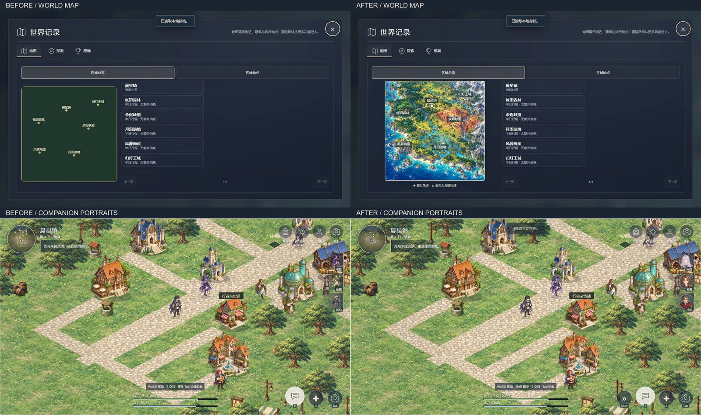

# 7.1 跑步、肖像、地图与资源清理

桌面 Shift 和手机“跑步”按钮均为按住生效，速度为 3.3 → 5.94 格／秒；松开立即恢复。移动方向归一化，碰撞检查仍分为最多 0.2 格的小步。现有四方向动画按 1.8 倍播放；减少动效设置仍生效。室外、内室、冒险路线共用移动循环；菜单、对话、加载、战斗、切换场景、失焦和旋转均清除输入，不增加存档字段。

主角、米拉、托伦、希薇、夜岚和瑟琳的头像直接裁自高清中性立绘，256×256 透明 WebP 共约 182 KiB。`assets/characters/avatar-crops.json` 记录来源和每个人物的裁切范围；运行 `node tools/build-character-avatars.cjs` 可重建。右侧队友栏、队伍列表与同伴好感列表共用 `CharacterPortraits.avatar`，加载失败保留通用职业头像。艾拉保持祭司肖像；详情仍使用完整立绘，头像不启动 Live2D。

世界底图使用内置 `image_gen.imagegen` 制作，提示词见 `assets/maps/generation.json`，原画保存为 `assets/maps/sources/world-v1.png`，发布图为 1024×1024 的 `assets/maps/world-v1.webp`（约 509 KiB）。底图无文字，六区域名称和当前位置由 Canvas 绘制；仅打开总览时加载，图片失败不阻断点击旅行。区域地点地图使用正交俯视坐标，按实际格子绘制地形、水道、道路、桥梁、建筑与装饰，图例和避让标签适配手机旋转。旅行消耗、地图入口和地标安全落点保持一致。

删除 164 张旧运行图片，合计 35,974,284 字节（34.31 MiB）：84 张旧环境 WebP、38 张旧场景 WebP、20 张旧建筑 512px PNG、20 张旧图标 128px PNG 和两张旧标题／加载图。原画、人物工程、Live2D 导出、通用头像及当前未提交美术素材均保留。清单 `assets/runtime-cleanup.json` 记录文件名、SHA-256、Git blob 和恢复版本 `f98c4ceddf10c709cb73cba17f23e1ff11250431`。

`node tools/resource-audit.cjs` 按当前清单和实际路径解析器审计六区域、64 场景、战斗人物、表情、备用头像、CSS 和地图。当前 343 项资源引用无缺失。`node tools/cleanup-resources.cjs` 默认只预览，`--apply` 才删除；拒绝删除未提交图片、工程原图和工作区以外路径。旧开发工具已更新到新版素材路径，历史图标的小尺寸预览只写入 `artifacts/legacy-icons/`。

## 验收

- `node tests/improvements-acceptance.cjs`：直接打开 HTML；跑步倍率、斜向归一化、碰撞、输入清理、室内／路线、立绘来源裁切、队友点击、六视口、手机双指和地图导航。
- `node tests/improvements-acceptance.cjs http://127.0.0.1:8080/frontier.html`：静态服务；另验证地图和头像缺失时的回退。
- 已通过 `resource-loading`、`layout-acceptance`、`loading-acceptance`、`viewport-acceptance`、`expansion-acceptance`、`static-portraits-acceptance`、`live2d-acceptance`、`environment-acceptance`、`world-acceptance`、`background-acceptance` 和主 `acceptance` 检查，覆盖旧存档迁移、51 内室、15 路线、任务／战斗与六种视口。
- 页面修改后运行 `node tools/build-game.cjs`；入口脚本和修改的样式采用 7.1 缓存版本。

新功能报告见 `artifacts/improvements/acceptance-file.json` 和 `acceptance-http.json`，运行日志及其他测试报告位于 `artifacts/`。地图／HUD 的真实前后对比见下图；原画和可编辑工程不进入删除清单。

